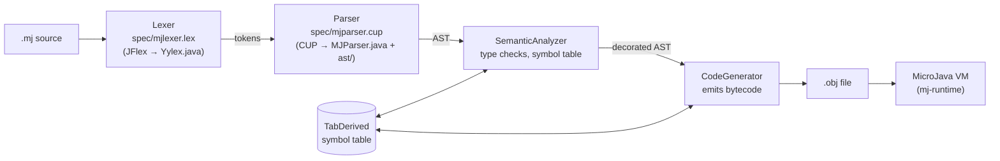

# MJCompiler: a MicroJava compiler

[](https://github.com/djokerg/microjava-compiler/actions/workflows/ci.yml)

A complete compiler for **MicroJava**, a small Java-like teaching language. It turns `.mj` source
into bytecode for the MicroJava virtual machine through four stages: a JFlex lexer, a CUP LALR(1)
parser that builds an AST, a semantic analyzer and a code generator. Built for the *Compiler
Construction 1* course (PP1) at the School of Electrical Engineering, University of Belgrade.

```
$ ./run.sh
== tests/test302.mj  (program input: 1 2 3 )
mjc: compiled test302.mj -> 992 bytes of MicroJava bytecode
mjc: running on the MicroJava VM
    0    1v   97
    4
    6
    6    6   12   18
  504    1    2    6
   12   18
    1    2    6
    6   12   18
```

## Quick start

You only need **Docker**. The first run builds the toolchain image (JDK 8 + Ant), which takes about a minute.

```bash
git clone https://github.com/djokerg/microjava-compiler.git && cd microjava-compiler

./run.sh                      # compile + run the main demo (tests/test302.mj)
./run.sh 301                  # another demo: 301, 302 or program
./run.sh path/to/hello.mj     # compile + run YOUR program (read() is interactive)
./run.sh --verbose 301        # also show tokens, syntax tree and symbol table
./run.sh --disasm program     # also show the generated bytecode
./run.sh test                 # regression suite
./run.sh shell                # shell inside the toolchain container
```

Try writing your own program:

```java
program demo
int arr[], rest[];
int i;
{
	int fact(int n) {
		if (n <= 1) return 1;
		return n * fact(n - 1);
	}

	void main() int n, first, second; {
		read(n);
		print(fact(n)); print(eol);

		arr = new int[4];
		for (i = 0; i < 4; i++) arr[i] = i * i;
		rest = new int[2];
		[first, second, *rest] = arr;          // array unpacking
		print(first); print(second); print(rest[0]); print(rest[1]);
	}
}
```

```
$ echo 5 | ./run.sh demo.mj
mjc: compiled demo.mj -> 199 bytes of MicroJava bytecode
mjc: running on the MicroJava VM
  120
    0    1    4    9
```

Errors are reported with line numbers, and the parser recovers to keep going (messages are in Serbian):

```java
program bad
{
	void main() int a; {
		a = 'x';
		print(b);
	}
}
```

```
$ ./run.sh bad.mj
error: Tip izraza nije kompatibilan pri dodeli - Semanticka greska na liniji 4
error: Ne postoji deklarisana promenljiva ili metod sa imenom b - Semanticka greska na liniji 5
error: Parsiranje nije uspesno zavrseno!
mjc: compilation of bad.mj failed
```

## Language features

| Area | Supported |
|---|---|
| Types | `int`, `char`, `bool`, one-dimensional arrays of each |
| Declarations | global and local variables, `const` (with literal values), methods with parameters and return values (recursion works) |
| Namespaces | `namespace N { ... }` containing constants, variables and methods, accessed as `N::name` |
| Statements | assignment, `++`, `--`, `if`/`else`, `for (init, ...; cond; update, ...)`, `break`, `continue`, `return`, `read(x)`, `print(e)` / `print(e, width)` |
| Expressions | `+ - * / %`, unary `-`, relational operators, short-circuit `&&` and `\|\|`, `new T[n]`, method calls |
| Built-ins | `ord(c)`, `chr(i)`, `len(arr)`, constant `eol` |
| Array unpacking | `[a, , b, *rest] = arr;` assigns elements in order, skips empty slots and copies the remainder into `rest` (with a runtime length check) |
| Not supported | classes, `static` blocks, `this` (the grammar parses them, but there is no semantic analysis or code generation; see [Limitations](#limitations)) |

## Architecture



`ant repackage` regenerates the lexer and parser from `spec/`. CUP's `-ast` mode also generates one
AST node class per grammar alternative (about 180 classes in `ast/`) and a `VisitorAdaptor`. The
semantic analyzer and code generator are both visitors walking that tree bottom-up. The driver,
[`test/rs/ac/bg/etf/pp1/Compiler.java`](test/rs/ac/bg/etf/pp1/Compiler.java), chains the stages and
writes the `.obj` file only when every stage succeeds.

## How it works

**Parser error recovery.** The grammar has `error` productions at declaration, parameter, `if`-condition and statement
level (e.g. `DesignatorStatementError`, `IfConditionError` in
[`spec/mjparser.cup`](spec/mjparser.cup#L239)). A syntax error skips to the next `;`, `,` or `)` and parsing
continues, so one run reports several errors.

**Short-circuit conditions via backpatching.** [`CodeGenerator`](src/rs/ac/bg/etf/pp1/CodeGenerator.java#L248)
compiles `a && b || c` without evaluating the whole expression. Every relational fact emits a
*false-jump* with a placeholder address. The addresses go into per-`if` lists (AND-block, OR-block,
THEN-block), which sit on stacks so `if`s can nest. The grammar contains empty marker nonterminals
(`IfStartDetected`, `ORBlockDetected`, `IfConditionEndDetected`, `ForTailDesignatorStart`, ...) purely to
give the visitor a hook at the exact moment a jump target becomes known, and that is where the lists get patched.

**`for` loops.** The generated code runs the condition, then jumps forward into the body, then back to the update
part and the condition again. `continue` jumps to the update, and each `break` adds an
exit address that is patched when the loop ends ([`CodeGenerator.java#L399`](src/rs/ac/bg/etf/pp1/CodeGenerator.java#L399)).

**Array unpacking.** `[a, b, *rest] = arr` first checks at runtime that
`arr` fits (otherwise `trap 2`), stores the leading elements, then runs a generated copy loop. The loop
counter is a hidden global, `$spec_iterator$`, which the semantic analyzer reserves at data address 0 when
the program starts ([`SemanticAnalyzer.java#L53`](src/rs/ac/bg/etf/pp1/SemanticAnalyzer.java#L53),
[`CodeGenerator.java#L451`](src/rs/ac/bg/etf/pp1/CodeGenerator.java#L451)).

**Namespaces without new scopes.** Namespace members go into the global scope under qualified names
(`Konstante::jedan`). Inside a namespace, an unqualified name is looked up first as-is, then with the
current namespace as a prefix ([`SemanticAnalyzer.java#L439`](src/rs/ac/bg/etf/pp1/SemanticAnalyzer.java#L439)).
That's visible in the symbol table dump (`./run.sh --verbose 301`):

```
Prog test301: notype, 0, 1
   Var $spec_iterator$: int, 0, 0
   Con Konstante::nula: int, 0, 0
   Con Konstante::jedan: int, 1, 0
   Con Konstante::pet: int, 5, 0
   Var Nizovi::niz: Arr of int, 1, 0
   ...
```

## Demos and tests

| Name | Program | Shows |
|---|---|---|
| `302` (default) | [`tests/test302.mj`](tests/test302.mj) | methods in namespaces, `if`/`else`, `for` with `break`/`continue`, short-circuit `&&`/`\|\|`, `read`, every form of array unpacking |
| `301` | [`tests/test301.mj`](tests/test301.mj) | constants, namespaces, arithmetic, `char` arrays, `++`/`--` |
| `program` | [`test/program.mj`](test/program.mj) | minimal program (arrays) |
| `303` | [`tests/test303.mj`](tests/test303.mj) | classes, inheritance, `static`. **Expected to fail**, since classes aren't supported |

`./run.sh test` ([`scripts/run-tests.sh`](scripts/run-tests.sh)) compiles each program and runs it on the VM
with scripted input from [`scripts/expected/`](scripts/expected/). It compares the output exactly and checks that
`test303` is rejected. CI runs the same suite on every push.

## Project layout

```
spec/mjlexer.lex, mjparser.cup   lexer and grammar (the source of truth)
src/rs/ac/bg/etf/pp1/
  SemanticAnalyzer.java          type checking + symbol table construction
  CodeGenerator.java             bytecode generation, jump backpatching
  TabDerived.java, DumpSymbolTableVisitorDerived.java   adds the bool type to the symbol table
  Yylex.java, sym.java           generated lexer / token constants (kept in the repo)
test/rs/ac/bg/etf/pp1/
  Compiler.java                  driver: lex → parse → analyze → generate
  MJTest.java                    lexer-only test driver
tests/*.mj, test/program.mj      MicroJava test programs
lib/                             course libraries (CUP, JFlex, log4j, symbol table, VM runtime)
build.xml                        Ant: repackage (generate lexer/parser) and compile
Dockerfile, run.sh, scripts/     one-command build, run and tests
```

## Building without Docker

The original workflow is IntelliJ with the Ant targets. You need a JDK 8 and Ant, and `logs/` must exist
because the `delete` step expects it:

```bash
mkdir -p logs out
ant repackage compile            # generate lexer/parser, compile src/
javac -d out -cp "lib/*" $(find src test -name '*.java')
java -cp "out:lib/*:config" rs.ac.bg.etf.pp1.Compiler tests/test301.mj test301.obj
java -cp "lib/*" rs.etf.pp1.mj.runtime.Run test301.obj
```

Source files must use **Windows (CRLF) line endings** (see below). `run.sh` converts them automatically.

## Limitations

- **Classes are not implemented** beyond parsing. `class`, `extends`, `static` and `this` are rejected
  during semantic analysis, and the compiler then stops with a `NullPointerException` instead of a clean error.
- **The lexer only recognises `\r\n` line endings.** A file with Unix (LF) line endings fails at the first
  newline with `could not match input`. The Docker scripts convert input to CRLF before compiling.
- Compiler messages are in Serbian.
- The line number in some error-recovery messages ("Izvrsen oporavak do ; u liniji N") can be off.
  The "Sintaksna greska na liniji N" line before it is accurate.

## Credits

Written by Đorđe Grebović as the semester project for **Programski prevodioci 1** (Compiler Construction 1),
**School of Electrical Engineering (ETF), University of Belgrade**, 2023/24.

Provided by the course: the libraries in `lib/` (CUP v10k, JFlex, log4j, the `symboltable` library and the
MicroJava VM `mj-runtime`), `src/rs/ac/bg/etf/pp1/util/Log4JUtils.java`, `config/log4j.xml`, the
`Compiler.java` / `MJTest.java` driver skeletons and the test programs `tests/test301–303.mj`.
MicroJava itself was designed by Hanspeter Mössenböck (JKU Linz) and adapted by the course.
